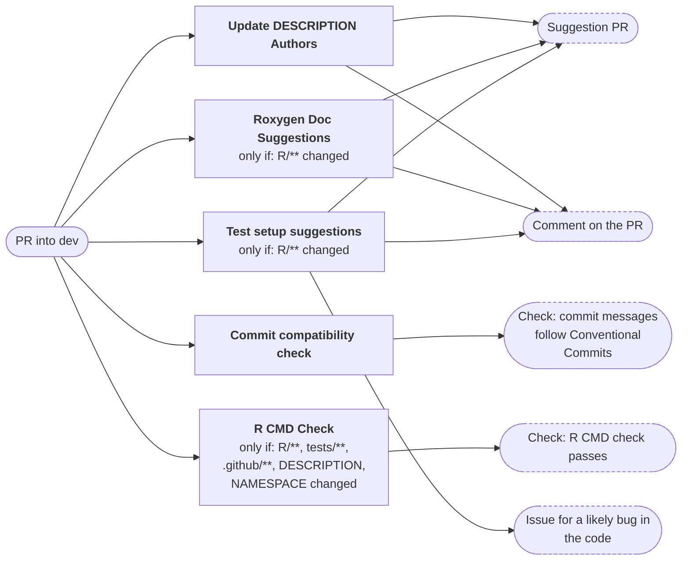
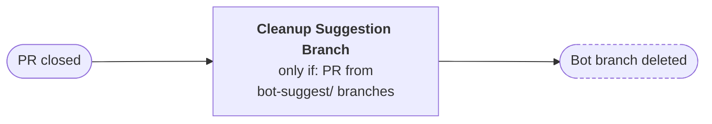
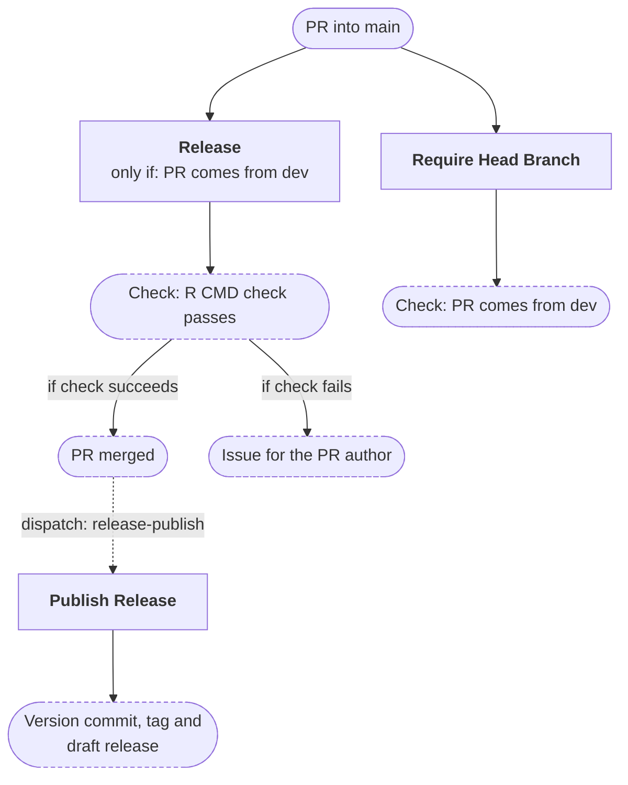
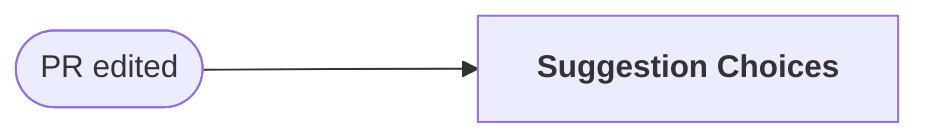
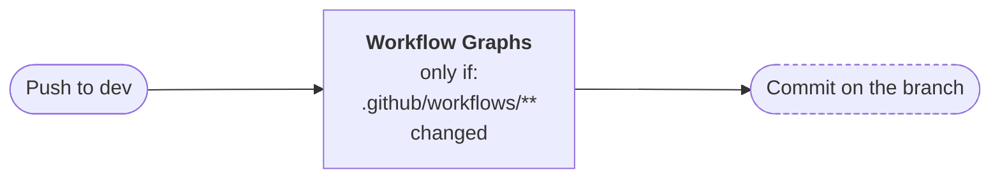
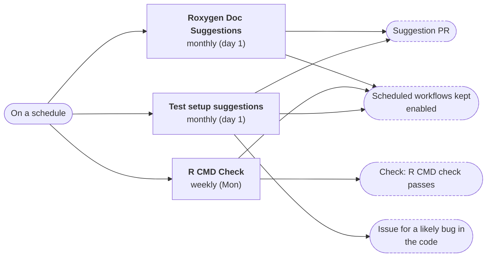

# Workflows

The GitHub Actions workflows of this repository, and how they connect.
The diagrams are generated from the workflow files by
[workflow-graphs](https://github.com/FlorianSchw/package-workflows) and
updated when the workflows change. Text outside the marked diagram
blocks is yours: add explanations anywhere, it is never overwritten.

<!-- workflow-graphs:overview:start -->
## All workflows

| Name | File | Runs on | Calls | Produces |
|---|---|---|---|---|
| Update DESCRIPTION Authors | `check-author-included.yml` | PR into dev | nfdi4health/datashield-workflows › authors-suggest.yml@v1/foundation | • Suggestion PR • Comment on the PR — *only if: pull request* |
| Commit compatibility check | `commitlint.yml` | PR into dev | nfdi4health/datashield-workflows › commitlint.yml@v1/foundation | Check: commit messages follow Conventional Commits |
| Roxygen Doc Suggestions | `docs-suggest.yml` | • PR into dev (only if: R/\*\* changed) • Monthly (day 1) • Manual run | • nfdi4health/datashield-workflows › roxygen-suggest.yml@v1/foundation • nfdi4health/datashield-workflows › workflow-keepalive.yml@v1/foundation | • Suggestion PR • Comment on the PR — *only if: pull request* • Scheduled workflows kept enabled — *only if: scheduled run* |
| R CMD Check | `R-CMD-Check.yml` | • PR into dev (only if: R/\*\*, tests/\*\*, .github/\*\*, DESCRIPTION, NAMESPACE changed) • Weekly (Mon) • Manual run | • nfdi4health/datashield-workflows › r-cmd-check.yml@v1/foundation • nfdi4health/datashield-workflows › workflow-keepalive.yml@v1/foundation | • Check: R CMD check passes • Scheduled workflows kept enabled — *only if: scheduled run* |
| Test setup suggestions | `test-suggest.yml` | • PR into dev (only if: R/\*\* changed) • Monthly (day 1) • Manual run | • nfdi4health/datashield-workflows › test-suggest.yml@v1/foundation • nfdi4health/datashield-workflows › workflow-keepalive.yml@v1/foundation | • Suggestion PR • Comment on the PR — *only if: pull request* • Issue for a likely bug in the code • Scheduled workflows kept enabled — *only if: scheduled run* |
| Cleanup Suggestion Branch | `cleanup-suggestion-branch.yml` | PR closed | nfdi4health/datashield-workflows › cleanup-suggestion-branch.yml@v1/foundation | Bot branch deleted — *only if: PR from bot-suggest/ branches* |
| Release | `release-trigger.yml` | PR into main | • nfdi4health/datashield-workflows › r-cmd-check.yml@v1/foundation • nfdi4health/datashield-workflows › merge-pull-request.yml@v1/foundation • nfdi4health/datashield-workflows › create-issue.yml@v1/foundation • nfdi4health/datashield-workflows › trigger-release-publish.yml@v1/foundation | • Check: R CMD check passes — *only if: PR comes from dev* • PR merged — *if check succeeds* • Issue for the PR author — *if check fails* • starts **Publish Release** |
| Publish Release | `release-publish.yml` | Dispatch: release-publish | nfdi4health/datashield-workflows › package-release.yml@v1/foundation | Version commit, tag and draft release |
| Require Head Branch | `require-head-branch.yml` | PR into main | nfdi4health/datashield-workflows › require-head-branch.yml@v1/foundation | Check: PR comes from dev |
| Suggestion Choices | `suggestion-choices.yml` | PR edited | nfdi4health/datashield-workflows › suggestion-choices.yml@v1/foundation | — |
| Workflow Graphs | `workflow-graph.yml` | • Push to dev (only if: .github/workflows/\*\* changed) • Manual run | nfdi4health/datashield-workflows › workflow-graphs.yml@v1/foundation | • Commit on the branch — *only if: push* • Note on the PR: runs on push only — *only if: pull request* |

## Events

What each event starts: the workflows (bold), what they produce (dashed boxes) and the workflows they start in turn (dotted arrows). **only if:** — happens only under this condition, e.g. when these files changed; **skipped:** — doesn't happen in this case. A label on an arrow applies to that arrow only ("if check fails").

### PR into dev

*When a pull request into dev is opened or updated.*

### PR closed

*When a pull request is closed.*

### PR into main

*When a pull request into main is opened or updated.*

### PR edited

*When a pull request is edited.*

### Push to dev

*On a push to dev.*

### On a schedule

*On a schedule.*

<!-- workflow-graphs:overview:end -->
